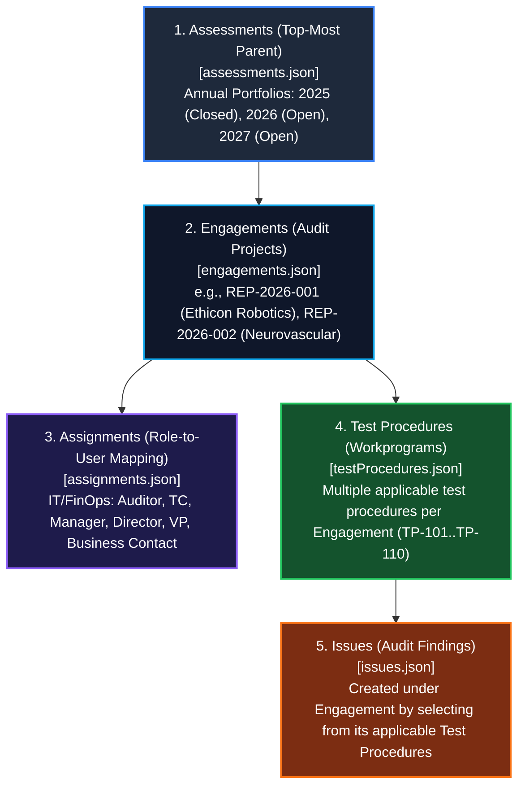
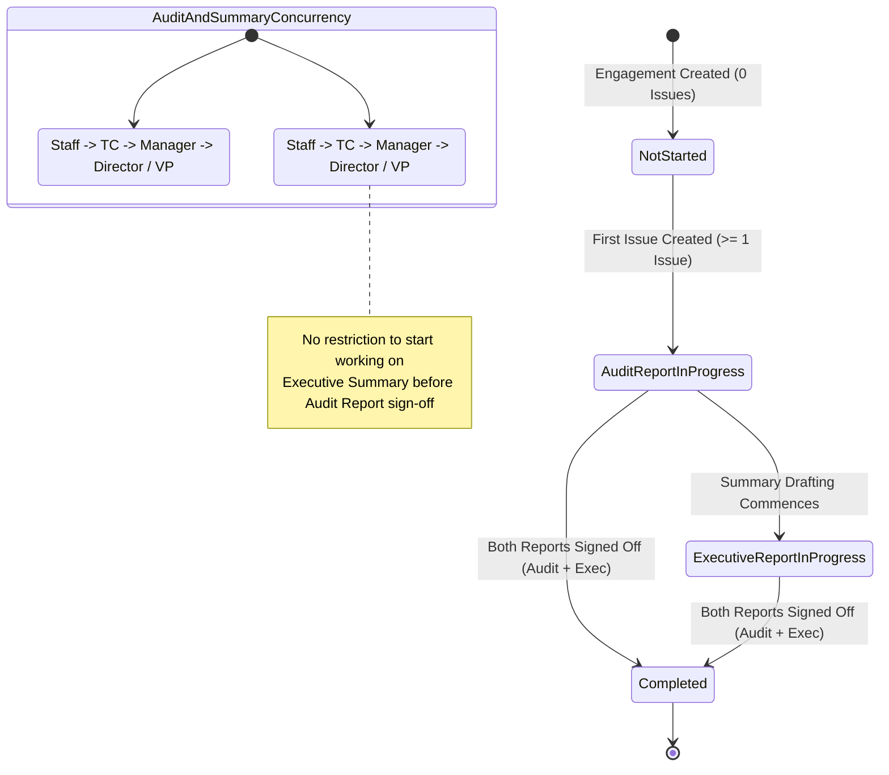
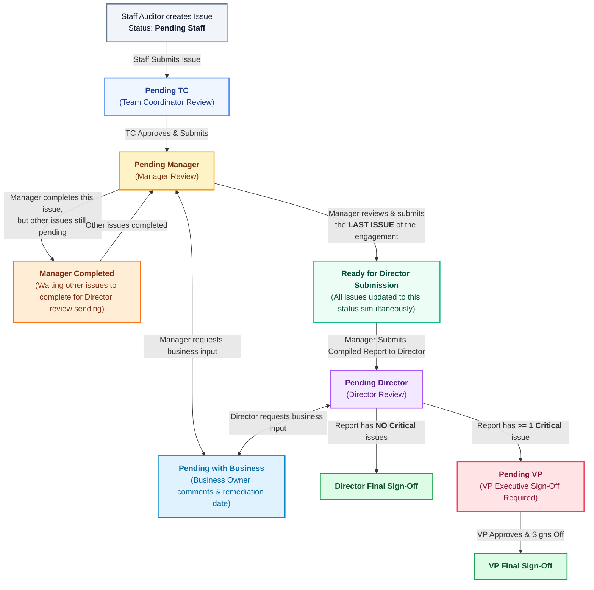
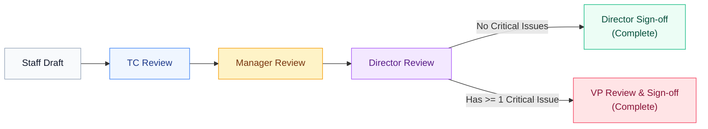

# Johnson & Johnson Internal Audit Reporting (IAR)
## System Architecture: Data Hierarchy, Workflow States & Sign-off Lifecycle

---

## 1. Enterprise Data Hierarchy



### Hierarchy Breakdown

| Entity Level | Source File | Description & Relationships |
| :--- | :--- | :--- |
| **1. Assessments** | [src/data/assessments.json](file:///d:/JnJ_IAR/src/data/assessments.json) | **Top-most Parent**. Holds annual internal audit plans (`ASM-2024` Re-Opened, `ASM-2025` Closed, `ASM-2026` Open, `ASM-2027` Open). |
| **2. Engagements** | [src/data/engagements.json](file:///d:/JnJ_IAR/src/data/engagements.json) | Child of Assessments. Each audit job (e.g. `REP-2026-001`) belongs to an `assessmentId`. Contains overall status, plant/location, and lead owner. |
| **3. Assignments** | [src/data/assignments.json](file:///d:/JnJ_IAR/src/data/assignments.json) | Mapped under Engagements. Maps each `engagementId` to Roles (`it-auditor`, `finops-manager`, `it-director`, etc.) and Users (`USR-001` .. `USR-018`). |
| **4. Test Procedures** | [src/data/testProcedures.json](file:///d:/JnJ_IAR/src/data/testProcedures.json) | Mapped under Engagements. Each engagement has multiple pre-approved/planned test procedures (e.g., `TP-101` Access Review, `TP-103` Telemetry, `TP-106` Scrap, `TP-110` GxP Validation). |
| **5. Issues** | [src/data/issues.json](file:///d:/JnJ_IAR/src/data/issues.json) | Created under an Engagement. Users log issues by selecting from that engagement's specific test procedures (`testProcedureId` / `testProcedureCode`). |

---

## 2. Engagement-Level Status Lifecycle



### Engagement State Transition Rules

1. **`Not Started`**:
   - Assigned by default when an engagement is initialized.
   - Rule: **0 issues** exist under the engagement.
2. **`Audit Report Inprogress`**:
   - **Automatic Trigger**: As soon as **at least one issue** is created under the engagement, the engagement status moves to `Audit Report Inprogress`.
3. **`Executive Report Inprogress`**:
   - Indicates active drafting and workflow progression of the Executive Summary Report.
   - **Concurrency Principle**: There is **no restriction** preventing the team from drafting or reviewing the Executive Summary report while the Audit Report is still in progress.
4. **`Completed`**:
   - Reached only when:
     - Audit Report has achieved final sign-off (by Director or VP).
     - Executive Summary Report has achieved final sign-off.

---

## 3. Issue-Level Status & Review State Machine



---

## 4. Issue-Level Detailed Lifecycle States

| Status Token | Current Stage | Action / Transition Trigger |
| :--- | :--- | :--- |
| **`Pending Staff`** | Draft by Staff Auditor | Staff auditor drafts finding, test procedure reference, root cause, and recommendations. |
| **`Pending TC`** | Team Coordinator Review | Staff submits issue $\rightarrow$ Routed to Team Coordinator to review technical consistency and evidence. |
| **`Pending Manager`** | Manager Review | TC submits $\rightarrow$ Routed to Audit Manager for formal supervisory review. |
| **`Pending with Business`** | Business Input Loop | **Interim Loop**: Either Manager or Director sends finding to Auditee/Business Contact for management response, action plan, and target remediation date. Once submitted, returns to Manager/Director. |
| **`Manager Completed (Waiting on Other Issues)`** | Interim Issue Completion | Manager completes review of this specific issue, but **other issues** under this engagement are still under Manager review. |
| **`Ready for Director Submission`** | Batch Trigger for Director | When the manager completes/submits the **last remaining issue**, **all issues** in that engagement transition to this status. Manager can now submit the compiled report to Director. |
| **`Pending Director`** | Director Quality Clearance | Manager submits audit report to Director. All issues display `Pending Director`. |
| **`Pending VP`** | Executive VP Sign-off | **Mandatory if $\ge 1$ Critical issue**: Director cannot execute sole sign-off; report and issues are elevated to VP. |
| **`Signed Off` / `Completed`** | Final Sign-off | Signed off by Director (if non-critical) or by VP (if critical). |

---

## 5. Executive Summary Report Workflow & Criticality Gate

### Review Chain
The Executive Summary Report follows the same governance hierarchy:
$$\text{Staff Auditor} \longrightarrow \text{Team Coordinator} \longrightarrow \text{Audit Manager} \longrightarrow \text{Audit Director} \longrightarrow \text{VP (if Critical Issues)}$$



### Sign-off Matrix

| Condition | Audit Report Sign-off Authority | Executive Summary Sign-off Authority | Final Engagement Status |
| :--- | :--- | :--- | :--- |
| **Report has NO Critical Issues** (Only Major / Moderate / Minor) | **Audit Director** can perform sole final sign-off | **Audit Director** can perform sole final sign-off | `Completed` |
| **Report contains $\ge 1$ Critical Issue** | Escalates to **Vice President (VP)** for final sign-off | Escalates to **Vice President (VP)** for final sign-off | `Completed` |

### Key Business Rule: Concurrency
* **No Blocking Dependency on Starting Executive Report**: Staff, TC, and Manager can begin drafting and consolidating the Executive Summary Report while the Audit Report is still active and undergoing field testing.
* **Final Sign-off Sequence**: The Audit Report issues must achieve Director/VP sign-off for audit closure, which feeds finalized figures into the final Executive Report completion.

---

## 6. Summary of Data Model Mapping

```json
{
  "assessments": "ASM-2026 (Annual Portfolio)",
  "engagements": "REP-2026-001 (Audit Project, status: Audit Report Inprogress)",
  "assignments": [
    { "role": "it-auditor", "users": ["Marcus Vance", "Sarah Jenkins"] },
    { "role": "it-team-coordinator", "users": ["Kevin Zhang"] },
    { "role": "it-manager", "users": ["Amanda Palmer"] },
    { "role": "it-director", "users": ["Brian Cox"] },
    { "role": "it-vp", "users": ["Robert Chen"] },
    { "role": "business-contact", "users": ["Thomas Wright"] }
  ],
  "testProcedures": [
    "TP-101: User Access & Authentication Review",
    "TP-102: Privileged Access Management Verification",
    "TP-103: Automated Telemetry & Calibration Logging Review",
    "TP-104: Segregation of Duties & Authorization Matrix",
    "TP-108: Change Management & Transport Release Verification",
    "TP-110: GxP Software Validation & Data Integrity Audit"
  ],
  "issues": [
    {
      "id": "ISSUE-001",
      "engagementId": "REP-2026-001",
      "testProcedureCode": "TP-101",
      "criticality": "Major",
      "status": "Pending TC",
      "title": "Semi-Annual User Access review exclusion of dormant users",
      "isLocked": false,
      "lockedBy": null,
      "lockedAt": null
    },
    {
      "id": "ISSUE-202",
      "engagementId": "REP-2026-002",
      "testProcedureCode": "TP-110",
      "criticality": "Critical",
      "status": "In Progress",
      "title": "Sterilization Batch Documentation Gap",
      "isLocked": true,
      "lockedBy": {
        "userId": "USR-002",
        "name": "Sarah Jenkins",
        "email": "sarah.jenkins@jnj.com",
        "role": "Staff IT Auditor",
        "avatar": "SJ",
        "activity": "Conducting retrospective biological indicator verification audit"
      },
      "lockedAt": "2026-08-04T11:15:00Z"
    }
  ]
}
```
