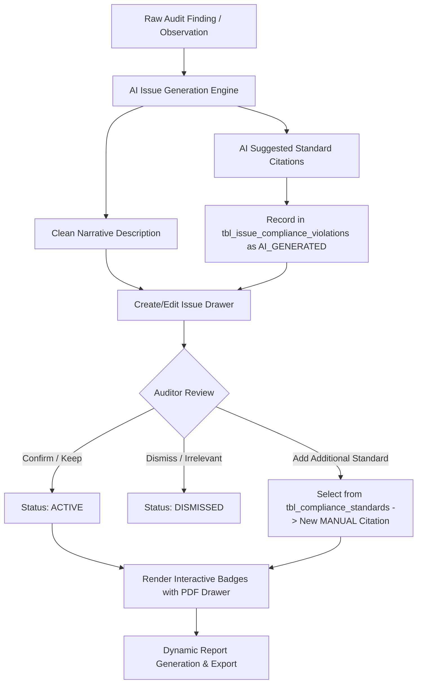

# Compliance & IAPP Standards Management

## 1. Overview & Problem Statement
In Johnson & Johnson internal audits, findings must cite governing policies, specifically the **Information Asset Protection Policies (IAPP)**, GxP (Good Practice), SOX (Sarbanes-Oxley), and regional regulatory standards.

Previously, these citations were concatenated directly into the freeform `description` text field during AI generation (e.g. `\n\nViolation Reference\nNon-Compliant with some of the sections of IAPP:\n1. S-15 Section No. [2]...`). This caused several architectural and operational deficiencies:
- **Relational Invisibility**: Standard citations could not be queried, indexed, or analyzed across audits (e.g. inability to compute *"Top 5 violated IAPP standards across MedTech in 2025"*).
- **Brittle Regex Parsing**: Freeform editing of descriptions by auditors risked corrupting dashed lines or section numbers, breaking clickable citation links and PDF document previews.
- **Conflation of Narrative & Governance**: The finding description should describe the *operational fact/deficiency*, while standard violations represent *normative governance mappings*.
- **Lack of Auditor Governance**: Auditors had no straightforward mechanism to add an un-cited standard or dismiss an irrelevant AI-suggested violation without manually editing raw text.

---

## 2. Relational Architecture

The compliance standards subsystem is normalized into two relational entities:

### 2.1 Master Standards Catalog (`tbl_compliance_standards` / `complianceStandards.json`)
The central authoritative library of all Johnson & Johnson internal and external governance standards.

| Field | Type | Description | Example |
| :--- | :--- | :--- | :--- |
| `standardId` | String (PK) | Unique standard identifier | `"STD-IAPP-S15"` |
| `code` | String | Short reference code | `"S-15"` |
| `title` | String | Official title of policy | `"Information Asset Protection Policy — System & Application Security"` |
| `category` | String | Governance domain | `"IT Security & Architecture"` |
| `version` | String | Active document revision | `"v4.2"` |
| `effectiveDate` | String (ISO) | Effective date of standard | `"2025-01-01"` |
| `pdfDocument` | String | Reference filename for PDF viewer | `"sample-iapp-standard.pdf"` |
| `sections` | Array | Catalog of numbered clauses | `[{ sectionNumber: "2", title: "...", requirement: "...", pdfPage: 4 }]` |

### 2.2 Issue Compliance Violations (`tbl_issue_compliance_violations` / `issueViolations.json`)
The junction entity associating a specific audit finding (`issueId`) with one or more standard sections.

| Field | Type | Description | Example |
| :--- | :--- | :--- | :--- |
| `id` | String (PK) | Unique citation identifier | `"VIOL-801-01"` |
| `issueId` | String (FK) | Target issue | `"ISSUE-801"` |
| `standardId` | String (FK) | Reference to master standard | `"STD-IAPP-S15"` |
| `standardCode` | String | Denormalized code for display | `"S-15"` |
| `sectionNumber` | String | Section or clause number | `"2"` |
| `sectionTitle` | String | Section clause title | `"Security Assessment for COTS Systems/Applications"` |
| `rationale` | String | Contextual explanation of the breach | `"Security assessment not completed for the environment"` |
| `source` | String | Origin of citation | `"AI_GENERATED"` \| `"MANUAL"` |
| `status` | String | State of citation | `"ACTIVE"` \| `"DISMISSED"` |
| `aiConfidence` | Number | AI certainty score (0.00 – 1.00) | `0.94` |
| `confirmedBy` | String | Name of confirming auditor | `"Dr. Aris Thorne"` |
| `createdAt` | String (ISO) | Creation timestamp | `"2025-11-12T10:30:00Z"` |

---

## 3. Lifecycle & User Workflows



### 3.1 AI Generation & Suggestion
- When an auditor inputs raw observations or runs AI generation, the AI engine extracts:
  1. `description`: Pure narrative text explaining the observation.
  2. `suggestedViolations`: Array of matched standard sections, with rationale and confidence score.
- The violations are saved to `issueViolations.json` with `source: "AI_GENERATED"`.

### 3.2 Auditor Review & Modifications
- In the Issue Detail view or Create Drawer, the auditor sees:
  - Clean observation description.
  - Dedicated **Violation References** block displaying active standards as interactive cards.
  - Clicking any standard launches `ViolationPdfDrawer` opened directly to the relevant policy clause and page.
  - The auditor can click **Dismiss** on an AI suggestion or **+ Add Standard** to search the catalog and attach another policy section.

### 3.3 Dynamic Export & Report Compilation
- When compiling official Audit Reports (PDF/Word), the system dynamically formats the standard citations into the formal corporate J&J reporting template:
  ```text
  Violation Reference
  Non-Compliant with some of the sections of IAPP:
  1. S-15 Section No. [2] - Security Assessment for COTS Systems/Applications — Security assessment not completed for the environment
  ```
- No hardcoded string markers are needed in the issue database, ensuring future-proof database normalization.

### 3.4 Backward Compatibility
- For existing legacy mock data or imported text where `Violation Reference` is embedded in `issue.description`, the compliance engine automatically separates the text on-the-fly and populates relational citations seamlessly.
