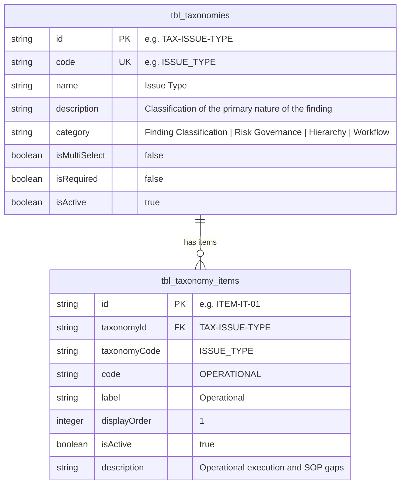

# Taxonomy Management Architecture

## 1. Overview & Purpose
In Johnson & Johnson Internal Audit Reporting (IAR), numerous attributes across assessments, engagements, test procedures, issues, and executive reports require controlled vocabularies.

Previously, these dropdown choices (e.g. `ISSUE_TYPE`, `ISSUE_SOURCE`, `KEY_THEME`, `IMPACTED_REGION`, `IMPACTED_SECTOR`, `IMPACTED_MRC`) were hardcoded as separate arrays in individual JSX files (`CreateIssueDrawerNew.jsx`, `AuditReportView.jsx`).

To prepare for a relational database model and provide enterprise-grade Master Data Management (MDM), these vocabularies are normalized into **Taxonomies** and **Taxonomy Items**.

---

## 2. Relational Schema Design



### 2.1 Taxonomies (`src/data/taxonomies.json`)
The master registry of taxonomy categories across the enterprise application.

| Field | Type | Description |
| :--- | :--- | :--- |
| `id` | String (PK) | Unique primary key (e.g. `TAX-ISSUE-TYPE`) |
| `code` | String (Unique) | Developer-friendly enum code (e.g. `ISSUE_TYPE`) |
| `name` | String | Human-readable title for UI display |
| `description` | String | Contextual explanation of the taxonomy purpose |
| `category` | String | Enterprise grouping (e.g. `Finding Classification`, `Workflow Pipeline`) |
| `isMultiSelect`| Boolean | Whether fields bound to this taxonomy support multiple selections |
| `isRequired` | Boolean | Whether an issue/record must select an item from this taxonomy |
| `isActive` | Boolean | Soft-deletion flag |

### 2.2 Taxonomy Items (`src/data/taxonomyItems.json`)
The individual options or values belonging to each taxonomy.

| Field | Type | Description |
| :--- | :--- | :--- |
| `id` | String (PK) | Unique primary key (e.g. `ITEM-IT-01`) |
| `taxonomyId` | String (FK) | Reference to `tbl_taxonomies.id` |
| `taxonomyCode` | String | Reference to `tbl_taxonomies.code` |
| `code` | String | Normalized uppercase item code |
| `label` | String | UI display string (e.g. `"Operational"`, `"Financial / SOX"`) |
| `displayOrder` | Integer | Custom sort sequence for UI dropdowns |
| `isActive` | Boolean | Soft-deletion flag |
| `description` | String | Detailed guidance on when to choose this option |

---

## 3. Seeded Taxonomies Inventory

| Taxonomy Code | Name | Category | Items Count | Example Options |
| :--- | :--- | :--- | :---: | :--- |
| `ISSUE_TYPE` | Issue Type | Finding Classification | 6 | Operational, Compliance, Financial / SOX, IT / Cybersecurity, Regulatory / GxP, Reputational / Strategic |
| `ISSUE_SOURCE` | Issue Source | Finding Classification | 6 | Internal Audit, External Audit (PwC), Regulatory Inspection (FDA / ISO), Management Self-Identified |
| `KEY_THEME` | Key Theme | Risk Governance | 6 | Access Governance, Financial Close, Manufacturing Telemetry, Third-Party Vendor Risk |
| `IT_ASSET_ACCOUNTABLE_SECTOR` | Accountable Sector | Organizational Hierarchy | 6 | Consumer, CORP, IM, ISRM, MT, TS |
| `IMPACTED_REGION` | Impacted Region | Geographical Hierarchy | 4 | APAC, EMEA, LATAM, NA |
| `IMPACTED_SECTOR` | Impacted Sector | Organizational Hierarchy | 6 | CPC, GS-NOP, MED, NOP, PHR, Ortho_Synthes |
| `IMPACTED_MRC` | Impacted MRC | Organizational Hierarchy | 5 | MRC-01 (Supply Chain), MRC-02 (Commercial), MRC-03 (R&D), MRC-04 (Shared Services), MRC-05 (Treasury) |
| `QUARTER_IMPACTED` | Quarter Impacted | Fiscal Calendar | 8 | Q1 2026, Q2 2026, Q3 2026, Q4 2026, Q1 2025, Q2 2025, Q3 2025, Q4 2025 |
| `CRITICALITY` | Issue Criticality | Risk Governance | 3 | Critical, Major, Minor |
| `AUDIT_FUNCTION` | Audit Function / Domain | Operational Scope | 5 | IT, FinOps, Quality Audit, Supply Chain, Manufacturing Operations |
| `ISSUE_CAUSE_TYPE` | Issue Cause Type | Root Cause Analysis | 7 | Operating Effectiveness, Design Effectiveness, Sensor Drift, Manual Entry Excursion |
| `PROCESS_AREA` | Process Area | Operational Scope | 10 | Global_Access_Management, Cybersecurity, Leasing, Cleanroom HVAC Unit 4, Catheter Line 3 |
| `BOOLEAN_FLAG` | Binary Flag | System Primitives | 2 | No, Yes |
| `ISSUE_STATUS` | Issue Workflow Status | Workflow Pipeline | 11 | Pending Staff, Pending TC, Pending Manager, Pending with Business, Signed Off, Closed |
| `ENGAGEMENT_STATUS` | Engagement Status | Workflow Pipeline | 4 | Not Started, Audit Report Inprogress, Executive Report Inprogress, Completed |

---

## 4. Developer API (`src/utils/taxonomyEngine.js`)

```javascript
import { getTaxonomyOptions, getTaxonomyItems, getAllTaxonomiesWithItems } from '../utils/taxonomyEngine';

// Get clean array of strings for dropdown options:
const issueTypes = getTaxonomyOptions('ISSUE_TYPE');
// => ['Operational', 'Compliance', 'Financial / SOX', 'IT / Cybersecurity', ...]

// Get structured item objects:
const regions = getTaxonomyItems('IMPACTED_REGION');
// => [{ id: 'ITEM-REG-01', code: 'APAC', label: 'APAC', displayOrder: 1, ... }]

// Get complete hierarchical taxonomy tree:
const allTaxonomies = getAllTaxonomiesWithItems();
```
